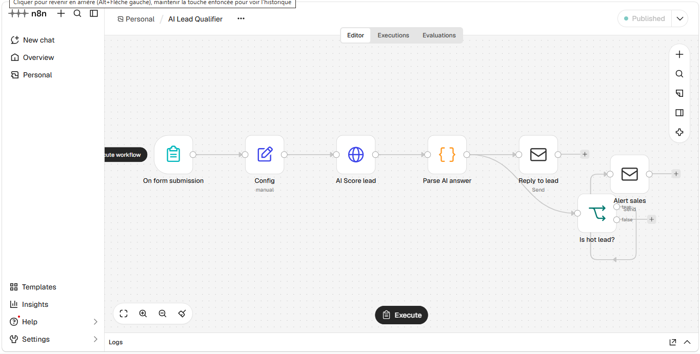

# AI Lead Qualifier — n8n + LLM

Automatically qualifies inbound leads, replies to every prospect in under a minute, and alerts the sales team when a lead is hot.

## The problem
Small agencies receive dozens of contact-form leads every week. Sorting them and writing replies by hand takes hours, and hot leads wait too long.

## The solution
1. A prospect fills in a web form (name, email, company, budget, project details).
2. An LLM scores the lead from 0 to 100 and classifies it as hot, warm or cold.
3. The prospect immediately receives a personalised reply, in their own language.
4. If the lead is hot, the sales team gets an alert email with an AI summary.

## Results (estimated)
- Response time: from hours to under 1 minute
- About 5 hours saved per week on lead sorting
- No hot lead left waiting

## Tech stack
- n8n (Form Trigger, HTTP Request, Code, If, Send Email)
- Gemini API through its OpenAI-compatible endpoint (works with OpenAI, Mistral or Groq by changing two settings)
- SMTP (Gmail or Brevo)

## Setup
1. Import `workflow/ai-lead-qualifier.json` into n8n.
2. Create two credentials: **Header Auth** (`Authorization: Bearer YOUR_API_KEY`) and **SMTP**.
3. Edit the **Config** node: `base_url`, `model`, `sales_email`, `company_name`.
4. Activate the workflow and share the form's production URL.

## Author
MAMA Daniel Dilane — AI automation · [LinkedIn](https://www.linkedin.com/in/daniel-mama-0254b1338/) · [Email](danielmama881@gmail.com)